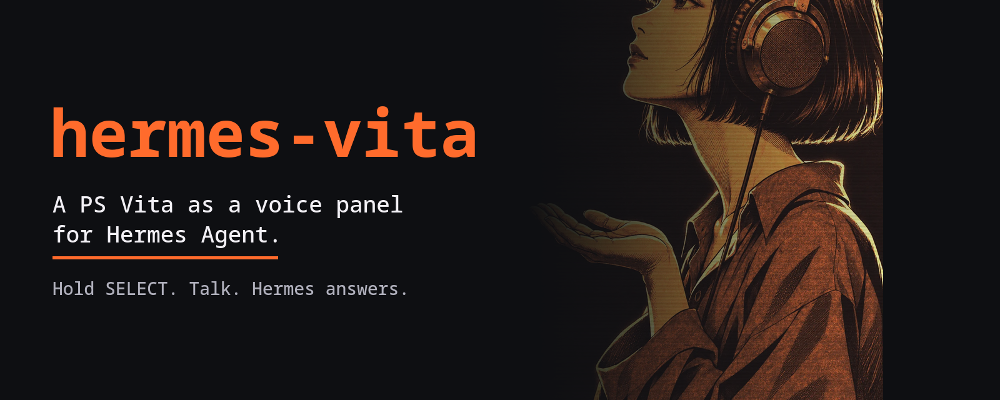

<p align="center"></p>

# hermes-vita

Turn a PS Vita into a little voice panel for [Hermes Agent](https://github.com/NousResearch/hermes-agent).

You hold SELECT, say what you want, and let go. Hermes does the work on your PC and the answer shows up on the Vita, in text and, if you like, out loud. A small animated portrait on the screen shows what Hermes is up to: listening, thinking, using a tool, speaking, or stuck.

It runs entirely on your own network. Nothing goes through anyone's cloud, and Hermes' API key never leaves your PC.

## What you get

- **Talk to Hermes** by holding SELECT (or the bar on the touch screen). Release to send. Triangle opens the keyboard, with Polish and English layouts.
- **Spoken answers** with a local voice (Piper). Square switches them on and off.
- **An animated portrait** with ten states: ready, listening, transcribing, thinking, working (it even says which tool), speaking, asleep, error, offline, not paired.
- **Eight prompt cards** ("status", "my day", "what needs my attention", ...). Add your own in a text file.
- **Sessions**: start a new chat, or pick an earlier Hermes session and keep going.
- **Live view of your real sessions** (optional plugin): when Hermes works on your PC in the desktop app or the terminal, the Vita shows it and reads out the answer.
- **Easy pairing**: one command on the PC prints a short text, you type it on the Vita once.

## How it fits together

```
 PS Vita  ----  your home Wi-Fi  ---->  bridge (Bun)  ---->  Hermes API (127.0.0.1)
 Hermes Pocket    one-use code            |   |
                  + device token          |   +--->  speech to text (any OpenAI-style server)
                                          |   +--->  Piper voice (local)
                       hermes-vita plugin +  (optional, loopback only, with a key)
```

## What you need

- A PS Vita with homebrew (VitaShell) on the same network as your PC
- [Hermes Agent](https://github.com/NousResearch/hermes-agent) with its API server on (`API_SERVER_ENABLED=true` and an `API_SERVER_KEY` in `~/.hermes/.env`)
- [Bun](https://bun.sh) and Docker (Docker is only used to build the app)
- For your voice to become text: any OpenAI-compatible transcription server, for example a local faster-whisper server
- For spoken answers: `ffmpeg`, plus about 90 MB for Piper and a voice

## Setup

```sh
scripts/build-vpk.sh          # builds dist/Hermes_Pocket.vpk
scripts/install-piper.sh      # optional: spoken answers (downloads about 90 MB)
scripts/install-plugin.sh     # optional: live view of real sessions
hermes plugins enable hermes-vita   # only if you installed the plugin; then restart Hermes

STT_URL=http://127.0.0.1:8000/v1/audio/transcriptions bun bridge/bridge.ts serve
```

Put the app on the Vita: in VitaShell press SELECT to start FTP, then

```sh
curl -T dist/Hermes_Pocket.vpk ftp://<vita-ip>:1337/ux0:/downloads/
```

and press X on the file in VitaShell to install it.

## Pairing

```sh
bun bridge/bridge.ts pair
# Pairing code 123456 (works once, 5 minutes).
# On the Vita: Hermes Pocket > LINK > X, then type:  192.168.1.20 123456
```

On the Vita open Hermes Pocket, go to the LINK page with R, press X, and type the address and code. That is it. To remove a Vita later: `bun bridge/bridge.ts revoke <name>`.

Prefer to let Hermes do it? There is a skill for that. `scripts/install-plugin.sh` also copies the `hermes-vita` skill, so you can just ask Hermes: "set up hermes-vita".

## Controls

| | |
|---|---|
| Hold SELECT | talk, release to send |
| Triangle | type a message |
| Circle | new chat |
| Square | spoken answers on or off |
| L / R | switch page: TALK, PANEL, SESSIONS, LINK |
| X | send a card, open a session, pair |
| Start | quit |

The touch screen works too: tabs, cards, the talk bar and scrolling.

## Your own cards

Create `ux0:data/pocket-hermes/presets.txt` on the Vita, one card per line:

```
BRIEF|Give me my morning brief in five lines.
```

## Is it safe?

The Vita cannot do modern TLS, so the bridge speaks plain HTTP on your home network. To make that acceptable it is deliberately narrow:

- a pairing code that works once and expires in five minutes
- a device token that is stored only as a hash and can be revoked
- a short list of routes; anything else is a 404
- size limits, a lock-out after five wrong guesses, and an audit log of every write
- Hermes' API key stays inside the bridge process

Do not expose the bridge port (4410) to the internet. The plugin talks to the bridge on 127.0.0.1 only, with its own key.

## Honest notes

- It is a hobby project, tested on one Vita and one PC. Expect rough edges.
- Spoken answers are English at the moment (any Piper voice works; set `PIPER_VOICE`). Hermes can still answer in any language in text.
- Opening an old session continues it as context for a new chat. Hermes' API does not allow resuming a session from another surface.
- Not affiliated with Sony or Nous Research.

## Tests

`bun test tests` runs the bridge tests: pairing, tokens, lock-out, limits, chat, sessions, voice, spoken answers and plugin events.

## Credits

Code is MIT. The font is Noto Sans Mono (SIL Open Font License). The portraits and the icon were generated for this project with Codex. Spoken answers use [Piper](https://github.com/rhasspy/piper) and a voice you download yourself, so check the licence of the voice you pick.
