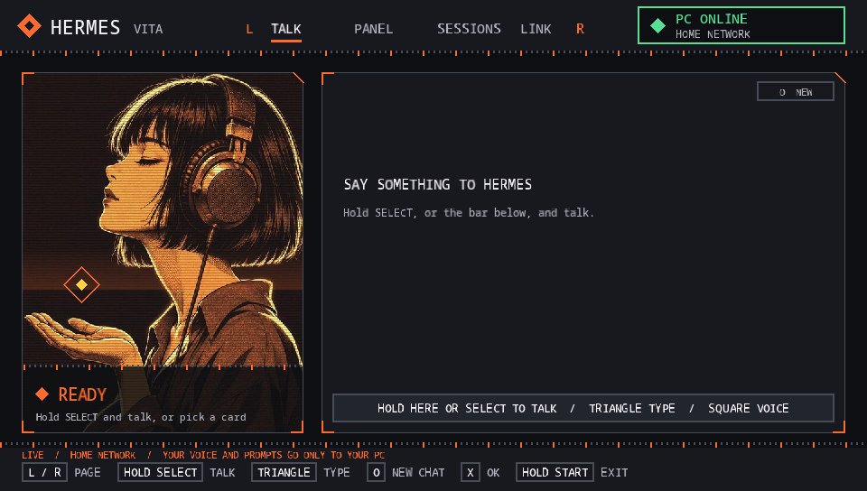
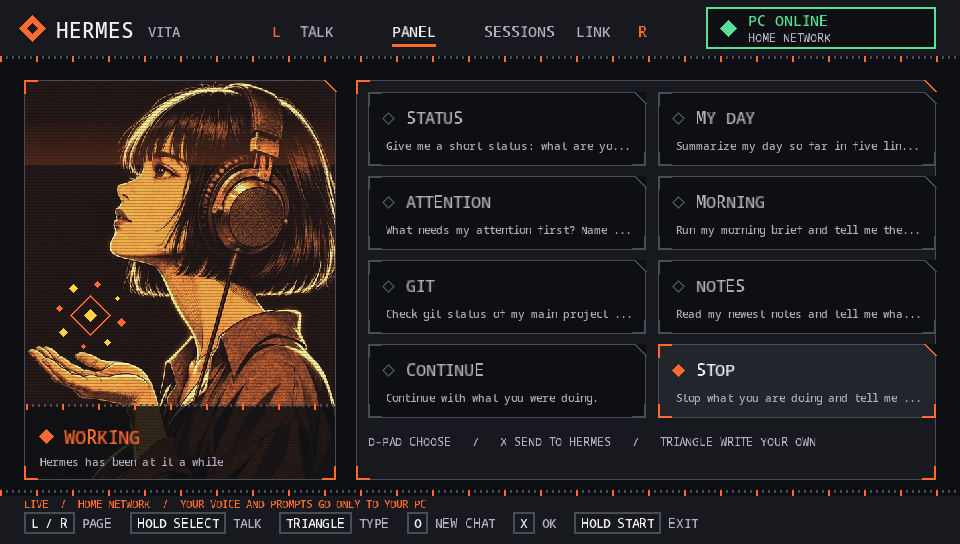

<p align="center"></p>

<p align="center">


</p>

# hermes-vita

Turn a PS Vita into a little voice panel for [Hermes Agent](https://github.com/NousResearch/hermes-agent).

Hold SELECT, say what you want, let go. Hermes does the work on your PC and the answer shows up on the Vita, in text and, if you like, out loud. A small animated portrait shows what Hermes is up to: listening, thinking, using a tool, speaking, or stuck.

Everything runs on your own network. No cloud in the middle, and Hermes' API key never leaves your PC.

<p align="center">
 
</p>
<p align="center"><sub>Left: the TALK page, ready. Right: the PANEL page while Hermes works on a request (the orb above the open hand is busy).</sub></p>

## Contents

[What you get](#what-you-get) · [How it fits together](#how-it-fits-together) · [What you need](#what-you-need) · [Setup](#setup) · [Pairing](#pairing) · [Controls](#controls) · [Updating](#updating-the-app) · [Your own cards](#your-own-cards) · [Is it safe?](#is-it-safe) · [Troubleshooting](#troubleshooting) · [Project layout](#project-layout)

## What you get

- **Talk to Hermes** by holding SELECT (or the bar on the touch screen). Release to send. Triangle opens the keyboard, with Polish and English layouts.
- **Spoken answers** with a local voice (Piper). Square switches them on and off.
- **An animated portrait** with ten states: ready, listening, transcribing, thinking, working (it says which tool), speaking, asleep, error, offline, not paired.
- **Eight prompt cards** ("status", "my day", "what needs my attention", ...). Add your own in a text file.
- **Sessions**: start a new chat, or pick an earlier Hermes session and keep going.
- **Live view of your real sessions** (optional plugin): when Hermes works on your PC in the desktop app or the terminal, the Vita shows it and reads out the answer.
- **Easy pairing**: one command on the PC prints a short text, you type it on the Vita once.
- **Updates from your PC**: no FTP after the first install.

## How it fits together

```
 PS Vita  ----  your home Wi-Fi  ---->  bridge (Bun)  ---->  Hermes API (127.0.0.1)
 HermesVita       one-use code            |   |
                  + device token          |   +--->  speech to text (any OpenAI-style server)
                                          |   +--->  Piper voice (local)
                       hermes-vita plugin +  (optional, loopback only, with a key)
```

## What you need

- A PS Vita with homebrew (VitaShell) on the same network as your PC
- [Hermes Agent](https://github.com/NousResearch/hermes-agent) with its API server on (`API_SERVER_ENABLED=true` and an `API_SERVER_KEY` in `~/.hermes/.env`)
- [Bun](https://bun.sh) for the bridge
- Docker, only if you build the app yourself (or just download the `.vpk` from [Releases](../../releases))
- For your voice to become text: any OpenAI-compatible transcription server, for example a local faster-whisper server (`STT_URL`, and optionally `STT_MODEL`, `STT_KEY` or `STT_HEADERS` as JSON)
- For spoken answers: `ffmpeg`, plus about 90 MB for Piper and a voice

## Setup

```sh
scripts/build-vpk.sh          # builds dist/HermesVita.vpk (or take it from Releases)
scripts/install-piper.sh      # optional: spoken answers (downloads about 90 MB)
scripts/install-plugin.sh     # optional: live view of real sessions
hermes plugins enable hermes-vita   # only if you installed the plugin; then restart Hermes

STT_URL=http://127.0.0.1:8000/v1/audio/transcriptions bun bridge/bridge.ts serve
```

Put the app on the Vita: in VitaShell press SELECT to start FTP, then

```sh
curl -T dist/HermesVita.vpk ftp://<vita-ip>:1337/ux0:/downloads/
```

and press X on the file in VitaShell to install it. (Keep the Vita awake, FTP stops when the screen sleeps.)

## Pairing

```sh
bun bridge/bridge.ts pair
# Pairing code 123456 (works once, 5 minutes).
# On the Vita: HermesVita > LINK > X, then type:  192.168.1.20 123456
```

On the Vita open HermesVita, go to the LINK page with R, press X, and type the address and code. To remove a Vita later: `bun bridge/bridge.ts revoke <name>`.

Prefer to let Hermes do it? `scripts/install-plugin.sh` also copies the `hermes-vita` skill, so you can just ask Hermes: "set up hermes-vita".

## Controls

| | |
|---|---|
| Hold SELECT | talk, release to send |
| Triangle | type a message |
| Circle | new chat |
| Square | spoken answers on or off |
| L / R | switch page: TALK, PANEL, SESSIONS, LINK |
| X | send a card, open a session, pair |
| Square (LINK page) | check for an app update and download it from the PC |
| Hold Start (1.5 s) | quit (a quick PS + Start still takes a screenshot) |

The touch screen works too: tabs, cards, the talk bar and scrolling.

## Updating the app

Build a new VPK on the PC (`scripts/build-vpk.sh`), keep the bridge running, then on the Vita open the LINK page and press Square. The app asks your PC for the newest build, saves it to `ux0:/downloads/HermesVita.vpk`, and you press X on that file in VitaShell to install.

## Your own cards

Create `ux0:data/pocket-hermes/presets.txt` on the Vita, one card per line:

```
BRIEF|Give me my morning brief in five lines.
```

## Is it safe?

The Vita cannot do modern TLS, so the bridge speaks plain HTTP on your home network. To make that acceptable it is deliberately narrow:

- a pairing code that works once and expires in five minutes
- a device token that is stored only as a hash and can be revoked
- a short list of routes; anything else is a 404
- size limits, a lock-out after five wrong guesses, and an audit log of every write
- Hermes' API key stays inside the bridge process

Do not expose the bridge port (4410) to the internet. The plugin talks to the bridge on 127.0.0.1 only, with its own key.

## Troubleshooting

| Problem | Try |
|---|---|
| The app closes right after launch | Read `ux0:data/pocket-hermes/log.txt` over FTP. A healthy start shows `portrait ok` and `init net=00000000` |
| "bridge not reachable" | The bridge is not running, the address is wrong (`ux0:data/pocket-hermes/config.txt`), or a firewall blocks port 4410 |
| "wrong or expired code" | Run `bun bridge/bridge.ts pair` again |
| "Hermes API is off on the PC" | Set `API_SERVER_ENABLED` and `API_SERVER_KEY` in `~/.hermes/.env`, restart Hermes |
| Nothing is spoken | Run `scripts/install-piper.sh`, restart the bridge, check its first line says "spoken answers on" |
| My voice is not understood | Set `STT_URL`; the bridge's first line says whether speech to text is on |
| VitaShell does not show the new file | Leave the folder and enter it again |

## Project layout

| Folder | What |
|---|---|
| `app/` | The Vita app (C, VitaSDK) |
| `bridge/` | The bridge (Bun, TypeScript) |
| `hermes-plugin/hermes-vita/` | The Hermes plugin that reports thinking, tool use, answers and errors |
| `skills/hermes-vita/` | A Hermes skill for setup and pairing |
| `scripts/` | Build, Piper and plugin installers |
| `art/` | The portrait and icon sources; `art/make-art.sh` rebuilds the app pictures |
| `tests/` | `bun test tests` |

## Honest notes

- A hobby project, tested on one Vita and one PC. Expect rough edges.
- Spoken answers are English at the moment (any Piper voice works, set `PIPER_VOICE`). Hermes can still answer in any language in text.
- Opening an old session continues it as context for a new chat. Hermes' API does not allow resuming a session from another surface.
- Not affiliated with Sony or Nous Research.

## Credits

Code is MIT. The font is Noto Sans Mono (SIL Open Font License). The portraits and the icon were generated for this project with Codex. Spoken answers use [Piper](https://github.com/rhasspy/piper) and a voice you download yourself, so check the licence of the voice you pick.
